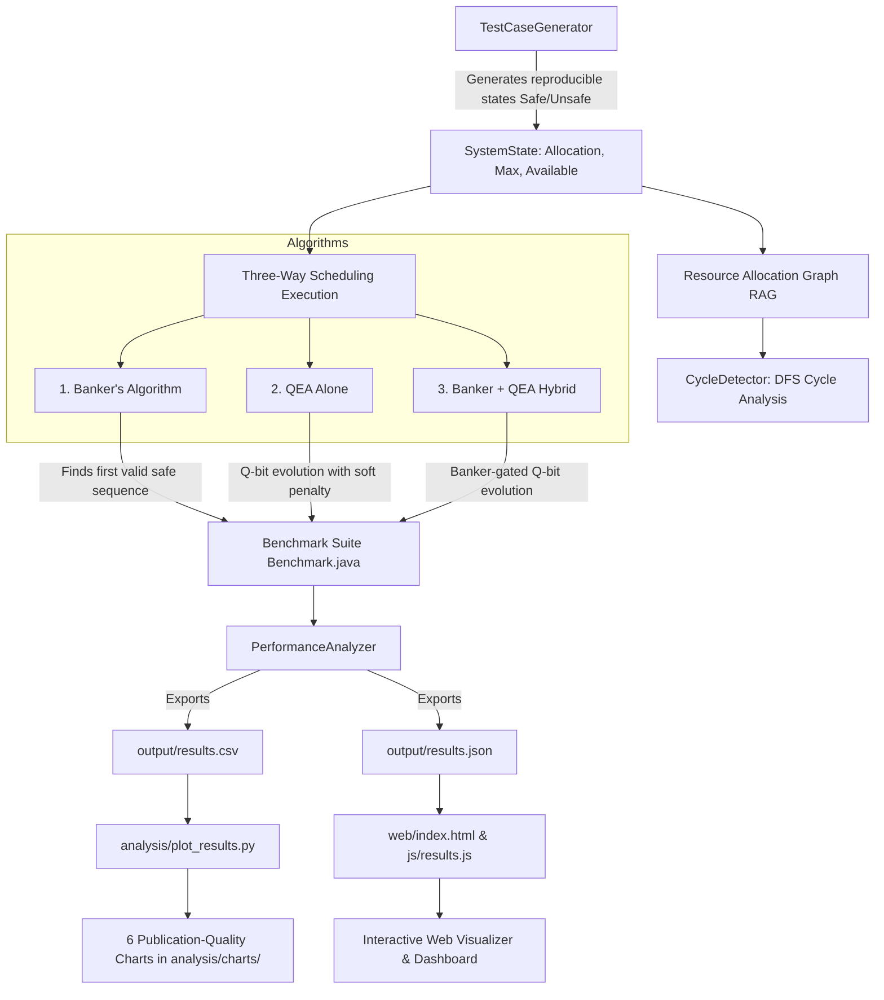

# Quantum-Inspired Optimization for Deadlock-Aware Process & Resource Scheduling

## 1. Executive Summary

In modern operating systems and distributed computing environments, resource management faces two competing challenges:
1. **Safety (Deadlock Avoidance):** Ensuring that processes requesting shared multi-instance resources never enter a circular wait state (deadlock) where progress stops completely.
2. **Efficiency (Optimal Scheduling):** Finding a process execution order that minimizes average waiting time, turnaround time, and resource idle wastage.

Classical approaches like **Dijkstra's Banker's Algorithm** guarantee safety in deterministic polynomial time $O(n^2 m)$, but they simply pick the first valid safe sequence they encounter—they do not attempt to optimize execution quality or throughput. 

This project implements, evaluates, and compares three distinct approaches under identical, controlled conditions:
- **Banker's Algorithm Alone:** The classical deterministic safety baseline.
- **QEA Alone (Quantum-Inspired Evolutionary Algorithm):** A metaheuristic algorithm using probabilistic Q-bit representations (superposition and rotation gates) to search for optimal schedules, treating deadlock as a soft penalty.
- **Banker + QEA Hybrid:** A constrained optimization system where Banker's algorithm serves as a strict safety filter inside the QEA fitness evaluation, ensuring the algorithm searches only within the provably safe solution space.

---

## 2. Core Concepts & Problem Formulation

### 2.1 The Deadlock Problem
A deadlock occurs when a set of concurrent processes are blocked because each process holds resources while waiting for other resources held by other processes. For a deadlock to persist, the four **Coffman conditions** must hold:
1. **Mutual Exclusion:** Resources cannot be shared simultaneously.
2. **Hold and Wait:** Processes hold allocated resources while requesting new ones.
3. **No Preemption:** Resources can only be released voluntarily by the holding process.
4. **Circular Wait:** A closed chain of processes exists where each waits for a resource held by the next.

### 2.2 Why "Quantum-Inspired"?
> **Clarification:** This project runs on standard classical hardware (JVM/Python). It does **not** require a physical quantum computer and makes **no claim of quantum supremacy or physical speedup**.

Instead, it adopts the mathematical formalism of quantum computing:
- **Q-bit Representation:** Instead of storing fixed binary choices ($0$ or $1$), each scheduling gene is represented by a Q-bit with a probability state vector $[\alpha, \beta]^T$, where $|\alpha|^2 + |\beta|^2 = 1$. The angle $\theta$ represents the superposition of scheduling choices.
- **Quantum Superposition:** A single Q-bit individual represents an entire probability distribution over candidate execution orders, allowing higher population diversity with smaller population sizes.
- **Rotation Gate Update:** Rather than random crossover and mutation, candidate solutions guide rotation angles $\Delta \theta$ via quantum rotation gates $U(\Delta \theta)$, shifting probabilities toward higher-fitness solutions.

---

## 3. The Three Scheduling Algorithms

| Metric / Aspect | 1. Banker's Algorithm | 2. QEA Alone | 3. Banker + QEA Hybrid |
| :--- | :--- | :--- | :--- |
| **Nature** | Deterministic baseline | Stochastic evolutionary metaheuristic | Constrained hybrid evolutionary |
| **Time Complexity** | $O(n^2 m)$ — Fast | $O(\text{generations} \cdot \text{pop} \cdot n \cdot m)$ | $O(\text{generations} \cdot \text{pop} \cdot n^2 m)$ |
| **Safety Guarantee** | 100% Guaranteed Safe | Soft penalty (not mathematically guaranteed) | 100% Guaranteed Safe (Hard Gate) |
| **Optimization Focus** | Safety only (first-found sequence) | Multi-objective (Wait time + Waste) | Multi-objective within safe subset |
| **Empirical Speed** | Baseline ($1\times$, $<1$ ms) | $4\times - 120\times$ slower | $5\times - 150\times$ slower |
| **Primary Value** | Fast, reliable admission control | High diversity exploration | High-throughput safe scheduling |

---

## 4. End-to-End System Flow

---

## 5. Architectural Pipeline & Steps

### Step 1: System State Representation (`SystemState`, `Process`, `Resource`)
Maintains vector and matrix structures for:
- **Allocation Matrix ($A$):** Resources currently held by process $P_i$.
- **Maximum Claim Matrix ($M$):** Maximum resources process $P_i$ may request.
- **Need Matrix ($N = M - A$):** Remaining resources needed by process $P_i$.
- **Available Vector ($V$):** Free resource instances currently available in the system.

### Step 2: Reproducible Benchmark Generator (`TestCaseGenerator`)
Generates 6 standardized problem sizes across fixed random seeds:
- Small: $10$ processes, $5$ resources
- Medium: $20$ processes, $5$ resources; $50$ processes, $10$ resources
- Large: $100$ processes, $15$ resources; $200$ processes, $20$ resources
- Very Large: $500$ processes, $30$ resources

### Step 3 & 4: Graph Theory & Cycle Detection (`ResourceAllocationGraph`, `CycleDetector`)
Constructs bipartite directed graphs with process and resource nodes. A recursive DFS cycle detector identifies closed dependencies.
- **Key finding:** For single-instance resources, a cycle confirms deadlock. For multi-instance resources, a cycle is necessary but **not sufficient**—Banker's algorithm must provide the definitive verdict.

### Step 5: Quantum-Inspired Optimization Engine (`QuantumBit`, `QuantumPopulation`, `FitnessFunction`)
- Maintains a population of Q-bit chromosomes.
- Observes/collapses quantum states into concrete process permutations.
- Evaluates fitness:
  $$\text{Fitness} = \text{WaitingTime} + \text{ResourceWaste} + \text{Penalty}_{\text{deadlock}}$$
- Applies quantum rotation gates to reinforce traits of the best-performing schedules.

### Step 6: Hybrid Integration (`QuantumInspiredOptimizer`)
Embeds Banker's Algorithm as an unyielding filter inside the fitness function. If a generated permutation leads to an unsafe state, it immediately incurs a maximum penalty ($\text{MAX\_VALUE}/2$), steering the evolutionary search entirely within valid execution orders.

### Step 7 & 8: Benchmarking & Visualization
- **`Benchmark.java` / `PerformanceAnalyzer.java`:** Runs 390 controlled trials with fixed seeds and zero cherry-picking, outputting standardized CSV and JSON metrics.
- **Python Plotting (`plot_results.py`):** Visualizes runtimes, fitness values, completion rates, convergence curves, and slowdown ratios using Pandas and Matplotlib.
- **Web Dashboard (`web/index.html`):** An interactive vanilla JS and Chart.js interface allowing users to step through Banker's allocation, inspect RAG cycle graphs, tweak QEA parameters, and explore benchmark data.

---

## 6. Key Empirical Takeaways

1. **Banker's Algorithm is unmatched in raw execution speed:** Being a deterministic greedy algorithm, Banker's Algorithm completes in under $1$ ms even for 500 processes.
2. **QEA discovers superior execution quality:** Where process order matters (e.g., minimizing time when resource instances sit idle), QEA finds more compact, lower-waste schedules.
3. **The Hybrid approach guarantees safety without sacrificing optimization:** The Banker+QEA hybrid never outputs an unsafe sequence while exploring multi-objective schedule improvements.
4. **Honest Trade-off:** The search quality of QEA comes at the cost of computational overhead ($4\times$ to $120\times$ slower than Banker's baseline).
